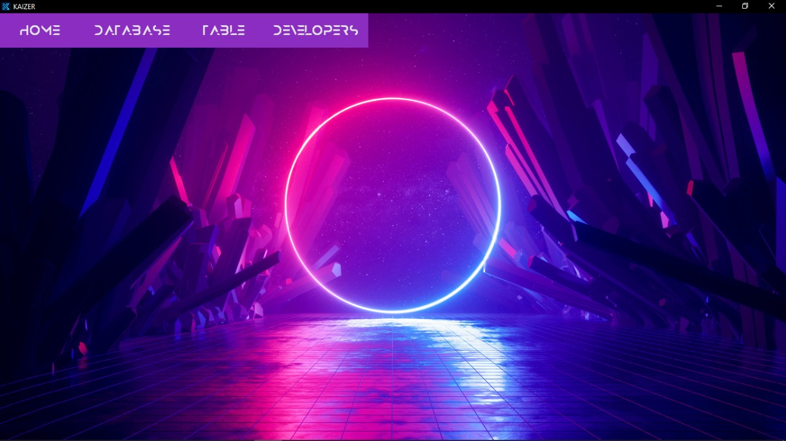
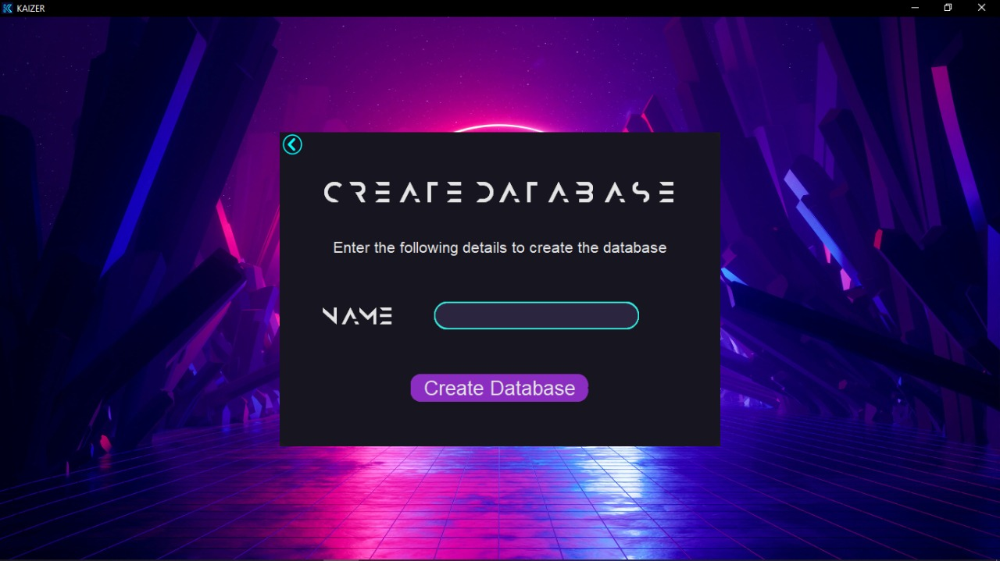
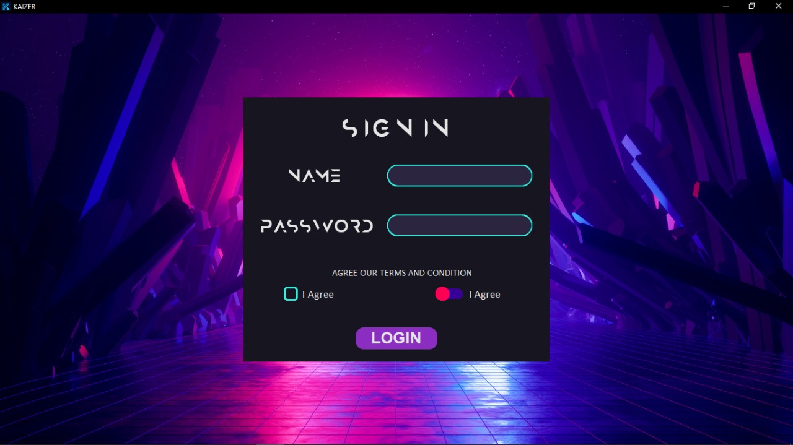
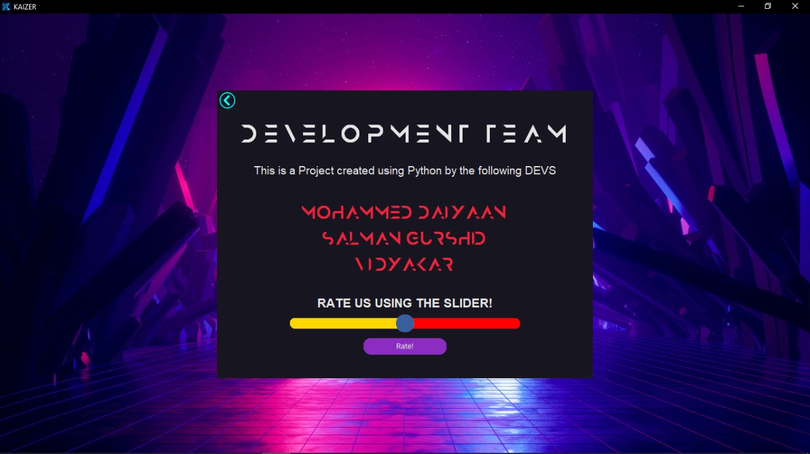
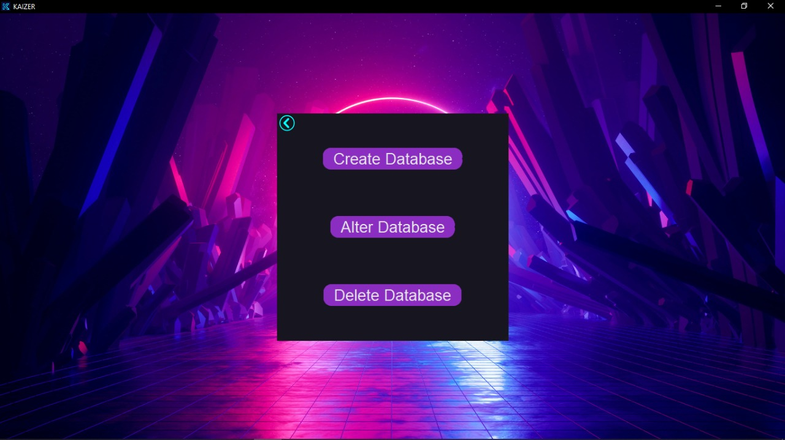
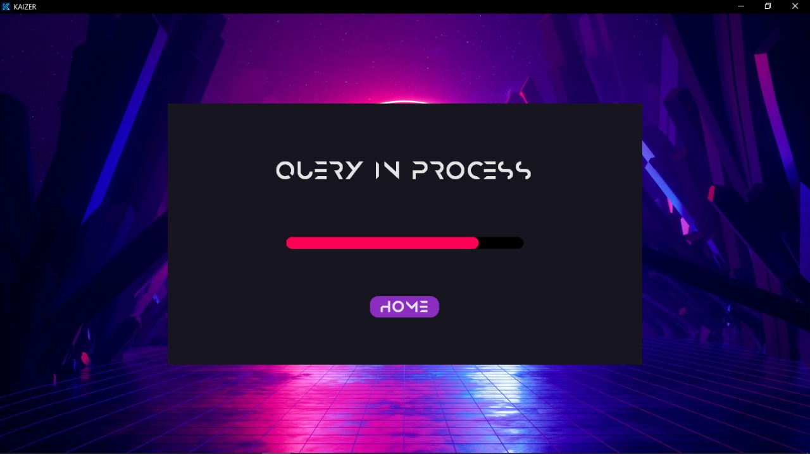

# Ultimate Database Manager  

## 📖 Introduction  
The Ultimate Database Manager is an easy-to-use application designed for users with little to no knowledge of databases. It allows users to create, modify, update, and delete databases through a user-friendly interface.  

---

## 🚀 Features  
- **Create Databases**: Generate new databases with custom names.  
- **Modify Databases**: Update existing databases with ease.  
- **Delete Databases**: Safely remove unwanted databases.  
- **User-Friendly Interface**: Designed with Python's Tkinter module for an intuitive graphical user experience (GUI).  

---

## 🛠️ Technology Stack  
- **Programming Language**: Python  
- **Database**: MySQL  
- **Modules Used**:  
  - `tkinter` for GUI development  
  - `mysql.connector` for backend database connectivity  

---

## 🏗️ Development Workflow  
1. **Import Required Modules**:  
   - `tkinter` for GUI  
   - `mysql.connector` for database connection  

2. **Create GUI**:  
   - Use Tkinter to create labels, buttons, and input fields.  

3. **Database Operations**:  
   - Use MySQL commands like `CREATE DATABASE <input>;`, `UPDATE`, and `DELETE` based on user inputs.  

---

## 💻 Installation  
1. Clone the repository:  
   ```bash
   git clone https://github.com/your-username/ultimate-database-manager.git
   cd ultimate-database-manager
   ```

2. Install dependencies:  
   ```bash
   pip install mysql-connector-python customtkinter
   ```

3. Run the application:  
   ```bash
   python main.py
   ```

---

## 📚 Usage  
The Ultimate Database Manager simplifies database operations, making it accessible to users without programming knowledge. Create, modify, and delete databases with just a few clicks!  

---

## 🖼️ Screenshots

### 🧭 Main Interface  


### 🏗️ Create Database  


### 🔐 Sign In  


### 💬 Feedback  


### 🗄️ Database Options  


### ⏳ Loading  


---

## 🌟 Contributing  
We welcome contributions! Please submit a pull request or open an issue for suggestions and improvements.  

---


## 🙏 Acknowledgments  
Thank you for checking out the Ultimate Database Manager!  

---

